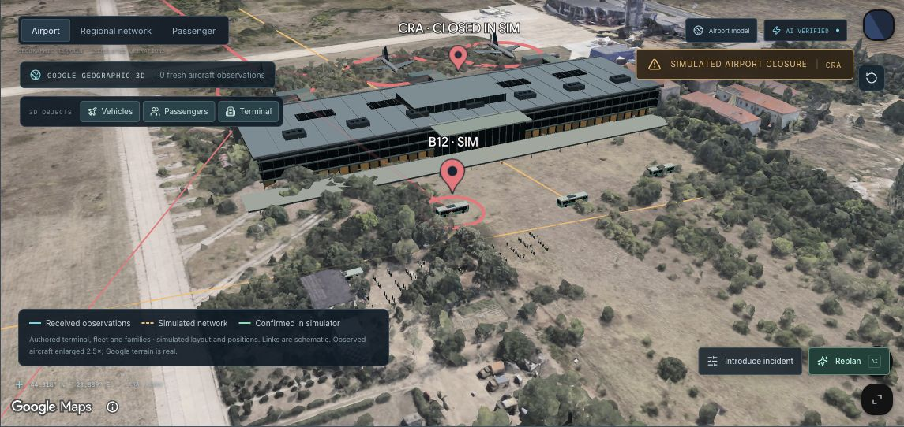

# Airport Recovery Live

Centru de operațiuni pentru recuperarea pasagerilor, cu **FastAPI, React/TypeScript, Three.js, Google Maps 3D și OpenAI**. Juriul modifică o situație prin voce sau text, iar agentul construiește strategii, evaluează inventarul comun și selectează un plan valid. Acceptarea pasagerului confirmă atomic întregul itinerar în simulator; refuzul eliberează toate segmentele ținute pentru grup.



Captură din aplicația funcțională: imaginile geografice sunt reale, iar pasagerii, incidentele și rezervările sunt simulate. **291 de teste trecute**; interpretarea Sol Ultrafast, selecția Decisions și încărcarea Google Maps au fost verificate cu furnizorii reali. [Rezultate și limite](docs/verification/report.md).

Specificația originală și imaginile de referință sunt în [docs/product-spec.md](docs/product-spec.md) și [docs/mockups](docs/mockups).

## Pornire locală

Necesită Python 3.12, Node.js 22.12+ și npm.

```bash
git clone https://github.com/ape-x/craiova_hackathon_2026.git
cd craiova_hackathon_2026
python3.12 -m venv backend/.venv
backend/.venv/bin/python -m pip install -r backend/requirements-test.lock
backend/.venv/bin/python -m pip install -e 'backend[test]'
test -f backend/.env || cp backend/.env.example backend/.env
chmod 600 backend/.env
cd frontend
npm ci
cd ..
./scripts/dev.sh
```

Aplicație: **http://127.0.0.1:5173**. API: http://127.0.0.1:8000. Documentația OpenAPI este disponibilă la `/docs` numai în dezvoltare.

Dacă `python3.12` nu este instalat, [instrucțiunile backend](docs/backend.md#run-locally) arată instalarea izolată prin `uv`. Adresele locale și QR-urile către localhost funcționează numai pe calculatorul gazdă. Pentru telefon și microfon de la distanță folosește instanța HTTPS descrisă în [lista de verificare a deployului](docs/deploy-checklist.md).

Fără chei API funcționează scena arhitecturală, inventarul, incidentele, solverul, ofertele și pagina mobilă. Interfața afișează **LOCAL SOLVER**. Comenzile în limbaj natural și vocea cer OpenAI; nu sunt înlocuite cu răspunsuri prestabilite.

## Scenariul inițial

- 180 de pasageri sintetici, în 72 de grupuri indivizibile.
- F101 anulat: 120 de persoane trebuie să ajungă din Craiova la Luton.
- F201: 60 de persoane într-un zbor de sosire, care pot necesita deviere.
- CRA, OTP și SBZ sunt nodurile regionale; LTN este destinația externă.
- 11 servicii de autocar, zboruri alternative și inventar hotelier limitat.

Apasă **Replan SOLVER** pentru prima alocare locală. Selectează o familie din `Passengers`, deschide linkul sau scanează QR-ul, apoi acceptă oferta. În `Scenario controls`, retrage B12 sau închide CRA: ofertele afectate se invalidează și inventarul este recalculat. Poți introduce capacități, bugete sau termene arbitrare; rezultatul nu este un scenariu precalculat.

## Scenarii libere, nu doar exemple

Prin voce sau text poți adăuga aeroporturi, curse de avion/autocar, cazare și familii noi, apoi să le schimbi condițiile în aceeași conversație. Agentul păstrează contextul clarificărilor și aplică împreună operațiile validate. Catalogul offline include 4.589 de aeroporturi reale; inventarul creat rămâne simulat. [Exemple, arhitectură și limite](docs/freeform-scenarios.md).

`Geographic 3D` activează separat Google Maps. Modelul propriu al terminalului este ilustrativ și este etichetat astfel. O randare reală a imaginilor și terenului Google la CRA, cu rute și marcaje de simulare, a fost verificată. Suprapunerea modelelor GLB a fost verificată vizual; terminalul propriu este ilustrativ, iar alinierea nu reprezintă o măsurătoare topografică.

## Configurarea integrărilor

Editează **backend/.env** local. Nu introduce chei în chat, în codul frontend sau în Git.

| Variabilă | Funcție |
|---|---|
| `OPENAI_API_KEY` | Responses Sol Ultrafast, Decisions Luna și GPT-Live |
| `OPENAI_MODEL`, `OPENAI_SERVICE_TIER` | Implicit `gpt-6.1-sol`, `ultrafast`; fără schimbare automată de model/tier |
| `OPENAI_DECISION_MODEL` | Implicit `gpt-6-luna` |
| `OPENAI_VOICE_MODEL` | Implicit `gpt-live-1` |
| `FR24_API_KEY` | Cheie pentru abonamentul API Flightradar24 |
| `GOOGLE_MAPS_API_KEY` | Cheie publică de browser restricționată la origini și Maps JavaScript API |
| `PUBLIC_BASE_URL` | Adresa accesibilă de pe telefon, folosită în QR |
| `OPERATOR_TOKEN` | Autentificarea operatorului; obligatoriu în producție |

Prezența cheii înseamnă **configurat**, nu acces verificat. [Documentația providerilor](backend/app/providers/README.md) descrie cererile exacte și verificările de cont. [Documentația hărții](docs/maps.md) descrie încărcarea, atribuirea și limitările geografice.

Vocea folosește WebRTC, transcriere, delegarea cererii către backend și un watchdog server pentru durata sesiunii. Microfonul necesită HTTPS sau localhost. Răspunsul vocal este trimis după rezultatul validat de server; modelul nu execută cod arbitrar.

Un test real cu audio sintetic a verificat conexiunea GPT-Live și închiderea confirmată a sesiunii, fără folosirea microfonului. Testarea comenzilor rostite, a delegării și a redării în browser rămâne un pas de validare cu echipa.

Flightradar24 rămâne oprit până la **Connections → Start live feed**. Colectarea este partajată între clienți, cu interval minim, limită de rezultate și buget persistent. Pozițiile observate au timestamp și sursă; nu furnizează capacitatea biletelor sau anulări deduse din absența unui avion. Sandbox, observații vechi și simulare sunt diferențiate.

Limitele implicite `FR24_BOUNDS=46.0,43.8,23.0,26.5` includ CRA, OTP și SBZ, în ordinea nord,sud,vest,est. Limita de cinci rezultate pe cerere nu garantează o observație la fiecare aeroport. O configurație `.env` existentă păstrează valorile vechi până când sunt editate explicit. Alegerea start/stop a feedului persistă după restart; un restart nu reîncarcă bugetul de cereri.

## Fluxul unei decizii

```text
Microfon / text
  → GPT-Live (pentru audio)
  → FastAPI: validarea cererii și versiunea stării
  → Sol Ultrafast: evenimente structurate și strategii
  → solver: alocări, timpi, costuri, verificarea constrângerilor
  → Decisions: alegere dintre variantele fezabile curente
  → tranzacție: reverificarea versiunii + reținerea tuturor resurselor
  → SSE către operator / actualizare către pagina pasagerului
  → acceptare idempotentă: confirmarea tuturor segmentelor
```

Solverul caută alocări fezabile printr-o euristică limitată. **Validitatea este verificată exact; optimalitatea globală nu este demonstrată.** AI-ul poate decide între alternative fezabile în funcție de cerere. Modul local determinist este disponibil explicit pentru dezvoltare și comparație.

Modelul operațional include capacitate pe segment, continuitate, timp de transfer, indivizibilitatea familiilor, accesibilitate, termene, bugete, ocuparea camerelor și incompatibilitatea curselor aceluiași vehicul. Hotelul este numai o componentă a unei călătorii complete. Confirmările neafectate se păstrează; retragerea unei resurse confirmate impune o ofertă nouă.

## Structura proiectului

```text
backend/app/
  main.py          API, autentificare, SSE, colectare partajată
  models.py        contractele validate
  seed.py          scenariul sintetic
  solver.py        căutare și verificare deterministă
  service.py       incidente, planuri, oferte și acceptări
  store.py         SQLite, tranzacții, versiuni și idempotency
  providers/       OpenAI Responses, Decisions, GPT-Live, FR24
frontend/src/
  App.tsx          centrul operațional și comenzile
  ResourceRail.tsx inventar și selecție
  Inspector.tsx    explicații, alternative, itinerarii și QR
  Passenger.tsx    experiența mobilă
  scene/           modelul 3D propriu și camera
  maps/            Google Maps geografic și observațiile externe
  liveVoice.ts     ciclul de viață WebRTC
deploy/            Caddy: fișiere statice, proxy API, SSE, TLS
scripts/           pornire, verificare și backup
```

## Verificare

```bash
./scripts/check.sh
```

Testele backend acoperă alocarea și concurența, versiuni depășite, familii, cazare, accesibilitate, bugete, invalidare în cascadă, expirare, persistență, autentificare și izolarea linkurilor pasagerilor. Testele providerilor verifică forma cererilor și răspunsurilor prin transport HTTP/WebSocket simulat. Acestea nu constituie apeluri reale la conturile externe. Testele frontend acoperă recuperarea unei cereri cu rezultat incert și proveniența suprapunerilor geografice. Buildul verifică TypeScript.

Verificarea vizuală urmărește fluxul complet în browser, la dimensiuni desktop și telefon. [Raportul de verificare](docs/verification/report.md) separă testele executate de integrările încă neverificate. Capturile efective sunt în [docs/verification](docs/verification); imaginile din `docs/mockups` sunt concepte, nu rezultate ale testelor.

La verificarea din 31 octombrie 2026 au reușit apeluri reale pentru interpretare **Sol Ultrafast**, selecție **Decisions** și prima randare geografică Google la CRA. Acestea sunt probe limitate de acces și funcționare, nu o validare completă a vocii, a modelelor 3D sau a conturilor pentru exploatare continuă. Credențialele și capturile consolei private de facturare nu sunt publicate; fiecare instalare folosește propriile conturi.

[Ghidul backend](docs/backend.md) descrie invariantele și limitele. [Măsurătorile locale](docs/benchmark-results.json) includ 180–300 de pasageri, mediană/p95 și mediul CPU; măsoară solverul și SQLite, fără a pretinde latență AI. Poți repeta măsurarea:

```bash
backend/.venv/bin/python backend/scripts/benchmark.py --samples 12 --passengers 180 240 300 --output docs/benchmark-results.json
```

## Rulare în containere

Pentru verificarea locală a buildului de producție:

```bash
docker compose up -d --build
curl --fail http://127.0.0.1:8080/api/ready
```

Deschide http://localhost:8080. Portul este legat numai de loopback, iar API-ul este accesibil prin proxy. Datele SQLite sunt păstrate într-un volum. Oprire: `docker compose down` — fără `-v`, pentru a păstra starea.

Pentru un server cu domeniu și HTTPS:

1. Creează configurația privată fără a suprascrie una existentă: `test -f .env.production || cp .env.production.example .env.production`, apoi `chmod 600 .env.production`.
2. Setează `APP_DOMAIN`, un `OPERATOR_TOKEN` aleator de minimum 32 de caractere și cheile disponibile. Nu folosi valorile de exemplu drept credențiale.
3. Configurează DNS-ul spre server și accesul la porturile 80/443.
4. Rulează:

```bash
docker compose --env-file .env.production -f compose.production.yaml up -d --build
```

Caddy gestionează TLS și proxy-ul. Backendul refuză configurația de producție fără token suficient de lung, URL HTTPS și origini/hosturi explicite. Linkurile pasagerilor sunt capabilități individuale, cu token în fragmentul URL al paginii; nu sunt publicate în exportul de audit. Logurile de acces sunt dezactivate în container pentru a nu înregistra tokenurile din endpointurile API.

[Lista de verificare a deployului](docs/deploy-checklist.md) include validarea configurației fără afișarea secretelor, readiness, autentificarea și testul de pe telefon. Nu expune direct portul API: configurația Uvicorn are încredere în headerele proxy deoarece numai rețeaua internă Caddy/API îl poate accesa.

Nu a fost publicată nicio instanță pe internet. Operarea reală cere conturi autorizate, verificarea accesului, cote și configurația organizației. Rezervările externe și controlul aeronavelor nu fac parte din acest simulator.

## Persistență și întreținere

SQLite folosește tranzacții și WAL, pe un volum local persistent. Configurația livrată rulează un worker API. Instanțe suplimentare pot folosi aceeași bază locală cu protecțiile tranzacționale; nu distribui fișierul SQLite între calculatoare sau volume de rețea. Pentru o implementare distribuită este necesară migrarea către o bază centralizată și coordonare operațională adecvată.

Backup consistent al unei baze locale active:

```bash
backend/.venv/bin/python scripts/backup.py backend/data/recovery.sqlite3 backups/recovery-snapshot.sqlite3
```

Snapshotul verificat are permisiuni `0600` și omite cache-ul observațiilor de trafic. Scriptul refuză suprascrierea unei destinații existente. Comanda de mai sus privește baza locală; baza Docker se află în volumul `recovery_data`, nu în `backend/data`. Restaurarea se face cu serviciul oprit, după salvarea stării curente. O copie simplă a fișierului `.sqlite3` în timpul rulării poate omite datele din WAL; folosește scriptul.

Feedul FR24 are un cache separat: `OBSERVATION_RETENTION_SECONDS=3600` implicit. Datele expirate sunt excluse la citire și curățate periodic chiar dacă feedul este oprit, cât timp aplicația rulează. Snapshoturile operaționale și rezultatele persistate de idempotency nu arhivează observațiile. Aceasta este politica tehnică a cache-ului, nu o garanție privind licența providerului. Pentru replay și orice altă utilizare verifică termenii contului. Istoricul operațional are o politică de retenție separată, încă de stabilit pentru un pilot de durată. Materialele 3D locale au atribuirea în manifestul lor; atribuirea Google rămâne vizibilă în hartă.

## Ce rămâne de verificat cu echipa

- O sesiune reală GPT-Live cu microfon, delegare, redare, întrerupere și închidere confirmată.
- O observație FR24 autorizată și afișată cu timestamp original; limitele abonamentului echipei.
- Verificările de facturare Google și restricțiile cheii; fotogrammetria detaliată a terminalului și randarea/alinierea modelelor GLB.
- Profilul vizual pe ecranul/proiectorul evenimentului și fidelitatea față de mockupurile fotorealiste.

Aceste verificări nu pot fi înlocuite de teste cu răspunsuri simulate sau de simpla prezență a unei chei.
