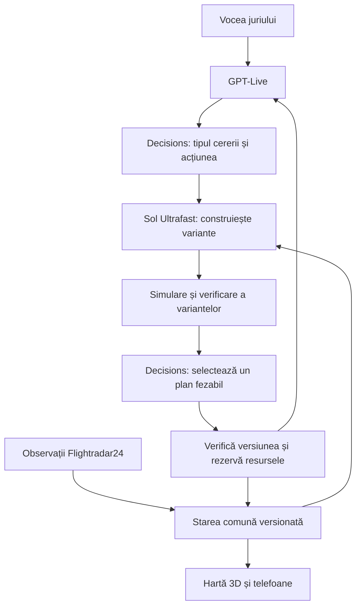

# Airport Recovery Live

## Centru de operațiuni 3D, controlat prin voce, pentru gestionarea perturbărilor aeroportuare

**Context:** [Craiova Hackathon](https://www.craiovahackathon.ro/), secțiunea AUTOPILOT.

**Versiune:** 1.1 — 31 octombrie 2026; conceptul și sursele comerciale au fost documentate inițial la 30 octombrie.

**Stadiu:** specificație de produs, cu implementare locală FastAPI + React. Adaptoarele OpenAI, Flightradar24 și Google Maps sunt implementate, dar accesul real și fidelitatea fotorealistă nu sunt încă verificate. Vezi [stadiul implementării și verificările](verification/report.md).

**Obiectivul demonstrației:** juriul schimbă situația prin voce, AI-ul ia decizii în timpul prezentării, iar consecințele apar într-o lume 3D coerentă.

> **Pitch:** „Pornim de la traficul aerian real. Voi schimbați condițiile. AI-ul reconstruiește planul pentru aeroport, transferuri și pasageri — iar voi vedeți fiecare consecință.”

## 1. Ideea produsului

Airport Recovery Live este un centru de coordonare a recuperării pasagerilor în urma unor incidente: anulări, întârzieri, autocare defecte, aeroporturi indisponibile și zboruri deviate. Produsul combină o hartă geografică 3D, trafic aerian observat, un simulator cu resurse limitate și modele AI care aleg acțiuni în funcție de situația curentă.

Un coordonator poate spune:

> „Autocarul B12 s-a defectat. Păstrează familiile împreună, respectă bugetul și găsește alternative pentru persoanele afectate.”

Sistemul identifică itinerariile dependente de autocar, construiește alternative, calculează consecințele și propune un plan fezabil. Dacă apare o nouă problemă, replanificarea ține cont de resursele deja ocupate și de ofertele acceptate.

**Clientul comercial propus:** compania aeriană.

**Utilizatorul principal:** coordonatorul operațional sau echipa de handling.

**Utilizatorul secundar:** pasagerul care primește și acceptă o ofertă.

**Rolul aeroportului:** sursă de context și partener operațional; nu presupunem că aeroportul deține inventarul de bilete al companiilor aeriene.

Problema centrală este alocarea globală a unor resurse limitate. O soluție bună pentru primul pasager poate consuma locurile de care are nevoie o familie întreagă. Sistemul trebuie să găsească variante compatibile pentru grupuri, păstrând continuitatea fiecărui itinerar.

## 2. Experiența pe care vrem să o obținem

Direcția vizuală se inspiră din precizia interfețelor geospațiale de operațiuni asociate cu Palantir și din interacțiunea cu o lume 3D modificată live din demonstrația Ultrafast de la DevDay. Identitatea produsului rămâne proprie.

Publicul trebuie să înțeleagă imediat:

1. Ce s-a întâmplat.
2. Cine și ce resurse sunt afectate.
3. Ce alternative există acum.
4. Ce a ales AI-ul și ce verificări a trecut planul.
5. Cum se schimbă situația după aplicarea lui.

Momentele de impact sunt legate de persoane și de dependențe reale în simulator: o familie primește o soluție; un autocar deja rezervat nu mai poate fi folosit de un al doilea grup; un zbor deviat generează cerere suplimentară de transport și cazare.

### Limbaj vizual

- Hartă 3D dominantă, aproximativ 70% din ecran.
- Suprafețe grafit și bleumarin, text clar, separatoare fine, informație ordonată.
- Cyan pentru trafic observat, amber pentru incidente și schimbări propuse, mint pentru alternative validate; roșu pentru resurse indisponibile.
- Semnificația este exprimată și prin etichete, simboluri și stiluri de linie.
- Trasee punctate pentru propuneri; trasee continue pentru itinerarii confirmate în simulator.
- Panou contextual în dreapta: incident, variante, efecte și explicația alegerii.
- Listă de resurse în stânga: aeroporturi, zboruri, vehicule și grupuri de pasageri.
- Bară vocală persistentă jos, cu transcriere și condițiile interpretate.
- Cronologie pentru evoluția scenariului și ocuparea resurselor.
- Camera urmărește evenimentul relevant, cu tranziții controlate și posibilitatea de a reveni la ansamblu.

### Trei niveluri de zoom

| Nivel | Ce vedem | La ce ajută |
|---|---|---|
| Regiune | Aeroporturi, aeronave, trasee aeriene și transferuri terestre | Compararea efectelor unei devieri |
| Aeroport | Terminal, porți, poziții ale resurselor și grupuri afectate | Înțelegerea incidentului local |
| Pasager | Familia, constrângerile, oferta și itinerarul complet | Legătura dintre decizie și experiența unei persoane |

O reproducere stilizată a sălii hackathonului poate fi introducerea: camera pornește din sala recunoscută de juriu și se ridică spre aeroport. Această secvență este opțională, după ce circuitul operațional funcționează.

## 3. Imagini de concept

Imaginile de mai jos sunt generate cu Imagegen. Sunt repere de design, nu capturi ale unei aplicații funcționale și nici reproduceri verificate ale aeroportului Craiova. Geometria, datele, datele calendaristice, zborurile și rezultatele afișate sunt ilustrative. Textul și cifrele vor fi înlocuite cu componente reale ale interfeței.

### 3.1 Vedere operațională a aeroportului


Scop: înțelegerea rapidă a situației și selectarea unui avion, autocar sau grup. Harta păstrează contextul, iar panoul de decizie se umple când apare un eveniment.

### 3.2 Autocar defect și refacerea transferului


Scop: vizualizarea relației dintre o resursă pierdută, pasagerii afectați și variantele de înlocuire. Alocarea ilustrată în imagine este un exemplu posibil; aplicația va calcula și selecta planul la rulare.

### 3.3 Devierea unui zbor și efectele regionale


Scop: trecerea de la un incident local la o problemă de rețea. Alegerea unui aeroport alternativ schimbă nevoia de autocare, camere și conexiuni.

## 4. Lumea simulată și datele reale

Aplicația va păstra separat observațiile externe și ramura de simulare. O comandă a juriului modifică scenariul; nu modifică istoricul observațiilor și nu transmite instrucțiuni către aeronave sau sisteme aeroportuare reale.

| Element | Proveniență propusă | Cum îl prezentăm |
|---|---|---|
| Poziția, altitudinea și viteza aeronavei | API Flightradar24 | Observat, cu ora ultimei actualizări |
| Terenul și contextul geografic | Google Maps JavaScript 3D | Hartă geografică; nivelul de detaliu depinde de acoperire |
| Terminalul, interiorul și unele obiecte 3D | Modele proprii, dacă sunt necesare | Reprezentare stilizată |
| Pasagerii și familiile | Date sintetice | Simulat |
| Locuri disponibile, camere și capacități de transport | Inventar controlat al scenariului | Simulat |
| Defecțiuni, închideri și devieri introduse de juriu | Comenzi vocale | Eveniment de simulare |
| Evoluția viitoare și timpii de sosire calculați | Motorul simulării | Estimare de scenariu |
| Oferte, rețineri și confirmări | Motorul intern de rezervări | Confirmat în simulator |

Modurile vizibile sunt **LIVE**, **SIMULATION** și, dacă folosim istoric accesibil conform abonamentului, **REPLAY**. În REPLAY, datele inițiale sunt istorice, dar AI-ul ia în continuare decizii noi în timpul demonstrației.

Mișcarea fluidă dintre două observații ale unui avion este interpolare grafică. Interfața afișează vechimea datelor; interpolarea nu reprezintă o măsurare nouă.

## 5. Scenariile demonstrației

Scenariile folosesc aceeași stare și același inventar. Nu resetăm automat resursele între incidente. Juriul poate modifica ordinea, capacitățile, termenele și obiectivele.

### Scenariul A — Anularea unui zbor

**Comandă posibilă:**

> „Anulează acest zbor în simulare. Găsește alternative și ține familiile împreună.”

Sistemul identifică pasagerii afectați și construiește itinerarii complete: alt zbor, transfer la alt aeroport urmat de zbor, sau cazare urmată de un zbor ulterior. Verifică disponibilitatea pe fiecare segment, transferurile și termenele.

În scenă apar ofertele și resursele pe care le-ar ocupa. Pasagerii acceptă pe telefon. Cazarea singură nu este considerată recuperarea completă a călătoriei.

### Scenariul B — Autocarul se defectează

**Comandă posibilă:**

> „Autocarul B12 s-a defectat. Nu mai poate transporta niciun pasager.”

Sistemul marchează vehiculul ca indisponibil, găsește itinerariile dependente și caută alternative. Păstrează confirmările neafectate. O confirmare care depinde de autocar devine explicit afectată și necesită o ofertă nouă.

Imaginea poate arăta 28 de pasageri și două vehicule cu 16 și 12 locuri, dar acestea sunt valori de exemplu. Juriul poate introduce alte capacități. Grupurile trebuie să încapă efectiv în vehicule, chiar dacă suma totală a locurilor pare suficientă.

### Scenariul C — Avionul nu mai poate ateriza la destinație

**Comandă posibilă:**

> „În acest scenariu, Craiova este indisponibilă pentru aterizare. Compară alternativele pentru avionul selectat.”

Simulatorul furnizează aeroporturile eligibile și constrângerile definite pentru exercițiu. AI-ul compară variantele și efectele asupra pasagerilor. București/Otopeni și Sibiu pot fi noduri ale scenariului, fără a presupune automat că sunt alternative fezabile pentru orice zbor.

Camera urcă la nivel regional. Traiectoria observată rămâne distinctă de traiectoria propusă în simulare. După selecție, apar cererile de transfer, cazare și refacere a conexiunilor.

Acesta este un exercițiu de decizie și recuperare operațională, nu un sistem certificat de planificare a zborului sau control al traficului aerian.

### Scenariul D — Constrângere nouă, aleasă de juriu

Exemple:

- „Hotelul mai are doar zece camere.”
- „Reduce bugetul disponibil cu 25%.”
- „Familia selectată trebuie să ajungă înainte de 22:00.”
- „Vehiculul B04 trebuie să fie accesibil pentru scaun rulant.”
- „Păstrează ofertele deja acceptate care sunt încă realizabile.”

AI-ul reevaluează planul pe baza acestor schimbări. Dacă toate opțiunile încalcă o condiție obligatorie, sistemul arată ce lipsește și ce cazuri au nevoie de intervenția coordonatorului.

## 6. Regia unei demonstrații de aproximativ patru minute

Timpii sunt un plan de prezentare, nu promisiuni de performanță ale modelelor.

| Interval | Acțiune | Efect urmărit |
|---|---|---|
| 00:00–00:30 | Prezentăm traficul și selectăm un zbor | Publicul recunoaște contextul geografic și separarea real/simulat |
| 00:30–01:15 | Juriul anulează un zbor sau cere primul plan | Apar itinerarii și consumul de resurse |
| 01:15–02:00 | Un autocar devine indisponibil | Se văd dependențele și replanificarea grupurilor afectate |
| 02:00–03:00 | Introducem devierea unui avion | Aceleași resurse sunt solicitate de un grup nou |
| 03:00–03:40 | Juriul inventează o constrângere | AI-ul trebuie să se adapteze la o valoare neanticipată |
| 03:40–04:00 | Un participant acceptă o ofertă | Telefonul și lumea 3D reflectă aceeași confirmare |

Un microfon dedicat juriului și un control explicit de vorbire ajută într-o sală zgomotoasă. Camera poate evidenția obiectul menționat în timpul vorbirii; schimbările de stare așteaptă interpretarea suficient de clară a cererii.

## 7. Ce face demonstrația nescriptată

Pregătim geometria, instrumentele, regulile și datele inițiale. AI-ul produce și selectează planul în timpul rulării.

- Variantele sunt construite din resursele și constrângerile curente.
- Juriul poate modifica valori și combinații care nu apar într-un scenariu pregătit.
- Alegerea unui aeroport sau a unui autocar nu este fixată în cod pentru un anumit moment al prezentării.
- Eșecurile sunt rezultate valide: sistemul poate constata că nu există o soluție fezabilă.
- Explicația este derivată din datele și rezultatele calculate.
- Rezultatele afișate provin din acțiuni aplicate asupra stării comune.

**Proba principală:** rulăm aceeași situație inițială cu două constrângeri diferite, alese de juriu, și vedem cum se modifică alocarea și consecințele. Un jurnal arată cererea interpretată, variantele evaluate, decizia, verificarea și starea rezultată.

## 8. Arhitectura AI

### 8.1 Rolurile componentelor

| Componentă | Rol propus |
|---|---|
| GPT-Live (`gpt-live-1`) | Conversație vocală, întreruperi, delegarea cererilor și comunicarea rezultatelor |
| Decisions API (`gpt-6-luna`) | Clasificarea evenimentului, alegerea acțiunii următoare și selecția dintre planurile fezabile curente |
| Responses API cu `gpt-6.1-sol`, Ultrafast | Interpretare structurată, construirea strategiilor și apelarea instrumentelor pentru evaluarea variantelor |
| Motor de simulare și solver | Calculul alocărilor, timpilor, costurilor și fezabilității pentru strategiile cerute |
| Orchestrator | Stare comună, ordonarea evenimentelor, anularea rezultatelor depășite și aplicarea tranzacțiilor |
| Motor grafic 3D | Poziții vizuale, trasee, tranziții de cameră și animații |

Decisions returnează răspunsuri de tip `predicate`, `choice` sau `score`; opțiunile unei alegeri sunt furnizate pentru cererea respectivă. Parametrii complecși și obiectele structurate sunt generate prin Responses. Lista planurilor oferită către Decisions se poate construi dinamic, după evaluarea situației. [Documentația Decisions](https://developers.openai.com/api/docs/guides/decisions)

GPT-Live are integrare nativă cu Decisions. Pentru fluxul complex, aplicația poate orchestra apelurile și instrumentele proprii. [Integrarea voce–Decisions](https://developers.openai.com/api/docs/guides/decisions-voice)

Ultrafast este configurat pentru apelurile Responses compatibile, separat de Decisions. Pentru acest proiect propunem Sol în Ultrafast, cu o conexiune persistentă unde este potrivită. [Documentația Ultrafast](https://developers.openai.com/api/docs/guides/ultrafast-mode)

### 8.2 Circuitul unei decizii



Pentru o comandă simplă, precum focalizarea camerei pe un obiect cunoscut, circuitul poate fi mai scurt. Pentru modificări operaționale complexe, se folosește evaluarea variantelor.

**AI-ul alege strategia și planul.** Instrumentele calculează exact rezultatele și resping încălcările. Validarea capacității nu se bazează pe probabilitatea returnată de model.

### 8.3 Instrumente propuse

Numele următoare sunt contracte interne propuse, nu funcții existente ale SDK-ului OpenAI:

| Instrument | Funcție |
|---|---|
| `get_world_state` | Citește un instantaneu versionat al scenariului |
| `apply_scenario_event` | Aplică un incident interpretat și validat |
| `get_affected_itineraries` | Identifică dependențele unei resurse sau ale unui zbor |
| `list_available_resources` | Întoarce disponibilitatea pentru intervalul cerut |
| `build_candidate_plan` | Construiește o alocare pentru o strategie și un set de constrângeri |
| `simulate_plan` | Calculează consecințele fără a modifica starea activă |
| `validate_plan` | Verifică toate condițiile obligatorii |
| `hold_plan_resources` | Reține temporar resursele pentru ofertele propuse |
| `confirm_offer` | Confirmă atomic toate segmentele unei oferte acceptate |
| `release_resources` | Eliberează reținerile expirate sau anulate |
| `focus_scene` | Mută camera și evidențiază obiectele relevante |

Un singur orchestrator deține autoritatea de aplicare a planurilor. Evaluările și căutările independente pot rula în paralel; modificările inventarului sunt coordonate central.

## 9. Modelul de date și starea comună

Entitățile principale:

- **Airport:** coordonate, facilități și disponibilitate în scenariu.
- **FlightObservation:** identificator, coordonate, altitudine, viteză, direcție, sursă și momentul observației.
- **ScenarioFlight:** resurse și restricții de simulare asociate unui zbor.
- **PassengerGroup:** membri sintetici, destinație, termen de sosire și nevoi declarate.
- **Resource:** autocar, loc pe un segment, cameră, poartă sau altă capacitate.
- **Itinerary:** segmente ordonate, timpi, cost și resurse necesare.
- **Offer:** itinerar, termen de acceptare și versiunea pe care a fost calculat.
- **Reservation:** reținere sau confirmare pentru resurse și intervale.
- **ScenarioEvent:** modificarea introdusă de juriu sau de motor.
- **DecisionRecord:** intrări, variante evaluate, alegere, validare și efecte.

Exemplu de eveniment intern:

```json
{
  "event_id": "evt_demo_104",
  "scenario_id": "scenario_craiova_01",
  "expected_world_version": 27,
  "source": "jury_voice",
  "type": "resource_unavailable",
  "resource_id": "bus_B12",
  "effective_at": "simulation_now",
  "interpreted_request": "Autocarul B12 nu mai poate transporta pasageri."
}
```

Fiecare plan este legat de versiunea stării pe care a fost calculat. Dacă o condiție relevantă se schimbă în timpul generării, planul este reevaluat înainte de aplicare. Actualizările de poziție fără impact operațional nu trebuie să declanșeze automat o replanificare completă.

## 10. Constrângeri și obiective

### Condiții obligatorii

- Capacitatea fiecărui segment și interval este respectată.
- Familiile și grupurile marcate indivizibile rămân împreună.
- Itinerarul este continuu de la punctul curent până la destinație.
- Transferurile și conexiunile sunt realizabile în modelul temporal.
- Resursele sunt compatibile cu nevoile declarate, inclusiv accesibilitatea.
- Termenele și bugetele marcate obligatorii nu sunt depășite.
- Un autocar nu poate realiza simultan două curse incompatibile.
- Camerele au reguli de ocupare; numărul de camere nu este confundat cu numărul de persoane.
- Aeroportul alternativ îndeplinește condițiile de eligibilitate ale scenariului.
- Confirmările neafectate sunt păstrate, în limitele regulilor stabilite de operator.

### Obiective configurabile

Ordinea inițială propusă este: cât mai mulți pasageri cu itinerar fezabil, respectarea termenelor, reducerea întârzierilor, apoi costul și numărul schimbărilor față de ofertele existente. Juriul poate schimba prioritățile, iar interfața arată obiectivul activ.

O familie cu patru membri poate necesita un bloc de patru locuri. Patru locuri rămase în vehicule diferite nu rezolvă această constrângere. Acesta este un exemplu simplu prin care demonstrația face vizibilă complexitatea alocării globale.

## 11. Oferte și rezervări în simulator

Fluxul unei oferte:

1. Se calculează un itinerar complet.
2. Se rețin temporar toate resursele necesare.
3. Oferta apare pe telefonul participantului.
4. Acceptarea confirmă toate segmentele într-o singură tranzacție.
5. Refuzul sau expirarea eliberează resursele.

Stările minime sunt: **necesită soluție**, **ofertă disponibilă**, **confirmat**, **afectat de incident** și **necesită intervenție**.

Apăsările repetate și mesajele retransmise nu dublează rezervările. Două persoane nu pot confirma același ultim loc. Dacă o resursă confirmată devine indisponibilă, itinerarul afectat își pierde explicit validitatea și primește o ofertă nouă.

Acțiunile operaționale sunt aplicate în simulator. Acceptarea pasagerului este un eveniment separat de selecția planului global de către AI. Animația unui itinerar reprezintă vizualizarea scenariului, nu dovada că persoana s-a deplasat fizic.

## 12. Performanță și senzația de interacțiune imediată

Separam feedbackul vizual de calculul unui plan. La început, scena evidențiază entitatea și incidentul înțeles. Variantele și efectele apar pe măsură ce sunt calculate și validate.

Măsuri propuse:

- Conexiuni persistente pentru voce și apeluri rapide, unde API-urile le permit.
- Instantanee compacte ale stării; trimitem modelului contextul relevant.
- Precalcularea relațiilor și a matricelor proprii de fezabilitate pentru scenariu.
- Evaluarea în paralel a variantelor independente.
- Replanificarea subansamblului afectat înaintea unei recalculări globale.
- Coalescența actualizărilor apropiate și evitarea deciziilor repetate pentru același eveniment.
- Randare și interpolare locale; nu apelăm modelul pentru fiecare cadru sau pasager animat.
- Limitarea numărului de variante și a buclelor de încercare; rezultatul poate fi și „nu există soluție în aceste condiții”.

### Ce măsurăm

| Măsurătoare | Definiție |
|---|---|
| Interpretare | De la finalul cererii vocale până la evenimentul validat |
| Decizie | De la eveniment până la alegerea unui plan valid |
| Aplicare | De la alegere până la actualizarea stării și a clienților |
| Circuit complet | De la finalul cererii până la rezultatul vizibil pe hartă și telefon |
| Prospețimea datelor | Vechimea observației de trafic folosite |

Raportăm mediana și percentila 95 în repetiții, cu condițiile testului. Nu fixăm în interfață valori de latență fictive. Viteza generării de tokeni nu este echivalentă cu latența întregului circuit.

## 13. Sursele de date și alegerea hărții

### Flightradar24

Abonamentul API este separat de abonamentul aplicației. Explorer este suficient pentru un experiment restrâns: la data documentului, planul public este 9 USD/lună plus TVA, cu limite de credite, rezultate și cereri. [Planuri oficiale](https://fr24api.flightradar24.com/subscriptions-and-credits/)

API-ul oferă observații de zbor și metadate, dar nu oferă plecări programate în viitor sau inventar de bilete. Absența unui avion din flux nu înseamnă automat anulare. Orarul viitor ar necesita o sursă separată; pentru MVP, segmentele viitoare și disponibilitățile sunt date de scenariu. [FAQ oficial](https://fr24api.flightradar24.com/docs/faq)

Pentru dezvoltarea inițială există un sandbox cu răspunsuri statice. Acesta nu reprezintă traficul live din Craiova. [Sandbox](https://fr24api.flightradar24.com/docs/sandbox-environment)

Conectarea live se face prin backend, cu o singură colectare partajată între clienți și o frecvență compatibilă cu planul. Nu ținem colectarea pornită inutil pe durata întregului hackathon. Modul de afișare, stocare și eventual replay trebuie să respecte licența utilizată. [Termenii serviciului](https://data-live.flightradar24.com/terms-of-service)

### Google Maps JavaScript 3D

Este prima opțiune pentru baza geografică. Suportă modele glTF proprii, poziție, altitudine și orientare, utile pentru aeronave și resurse. [Modele 3D](https://developers.google.com/maps/documentation/javascript/3d/models)

Acoperirea fotorealistă a suprafeței exacte a aeroportului Craiova trebuie verificată practic. Prezența imaginilor satelitare nu garantează clădiri reconstruite în 3D sau interiorul terminalului. [Acoperire](https://developers.google.com/maps/documentation/javascript/3d/coverage)

Pentru proiectele noi cu facturare în SEE există o restricție privind Photorealistic 3D Tiles prin Map Tiles API. Google indică 3D Maps JavaScript drept alternativă. Schimbarea motorului de randare nu elimină restricția sursei de date. [Condiții SEE](https://developers.google.com/maps/comms/eea/map-tiles)

Dacă detaliul local este insuficient, suprapunem un model propriu al aeroportului peste baza geografică. Un motor alternativ precum CesiumJS poate fi evaluat cu date și imagini licențiate pentru acest tip de utilizare; nu presupunem că orice fundal disponibil permite urmărirea flotelor. [Utilizarea și atribuirea conținutului Cesium](https://cesium.com/learn/ion/content-usage-and-attribution-guide/)

Harta nu furnizează automat rute de transfer, timpi operaționali sau capacități. MVP-ul folosește trasee și timpi prevalidate în scenariu; conectarea la un serviciu de rutare este o extensie separată.

## 14. Implementarea propusă

Aceasta este o arhitectură de lucru, nu o configurație deja instalată.

Înaintea implementării dependente, confirmăm accesul proiectului prin câte un apel reușit la GPT-Live, Decisions și Sol Ultrafast. Același prag se aplică hărții și fluxului FR24. Disponibilitatea documentată a unui serviciu nu confirmă existența cheilor, creditelor și limitelor necesare în conturile echipei.

| Strat | Propunere |
|---|---|
| Interfață principală | TypeScript și React, cu hartă Google 3D și panouri proprii |
| Voce | GPT-Live în browser, prin conexiunea recomandată pentru audio |
| Orchestrare | Backend TypeScript, adaptoare pentru sursele externe și instrumentele AI |
| Solver și simulare | Modul determinist; serviciu Python dacă alegem un solver precum OR-Tools |
| Stare | Magazin autoritativ pe server; SQLite sau PostgreSQL pentru evenimente și rezervări |
| Actualizări către interfețe | WebSocket sau SSE, în funcție de necesitățile fluxului |
| Interfață pasager | Pagină mobilă accesată prin QR, cu identitate fictivă și ofertă individuală |

Cheile modelelor și Flightradar24 rămân pe server. Cheia de hartă destinată browserului se restricționează la aplicație și API-urile necesare. Comenzile vocale sunt transformate în acțiuni cu schemă și parametri validați; aplicația nu execută cod arbitrar generat de model.

Un eveniment este etichetat cu sursa și timpul său. Observațiile externe, cererile utilizatorului și rezultatele simulării nu sunt confundate în contextul transmis modelelor.

## 15. Ce intră în MVP-ul de hackathon

### Obligatoriu

- Un aeroport principal și două noduri alternative ale scenariului.
- 3–5 zboruri selectate dintr-un flux real sau din istoric licențiat, când sunt disponibile.
- 100–300 de pasageri sintetici grupați în familii și grupuri.
- Inventar limitat de locuri, autocare și cazare, cu intervale temporale.
- Hartă geografică 3D, modele de aeronave și trasee actualizate din stare.
- Cele trei incidente principale: anulare, autocar defect, deviere simulată.
- Comenzi vocale cu valori și combinații neanticipate în limitele instrumentelor implementate.
- Construirea și selecția live a planurilor prin modelele propuse.
- Verificare deterministă înainte de aplicare.
- Oferte pe telefon, acceptare și actualizare sincronizată.
- Jurnalul deciziei, timpi măsurați și marcarea provenienței datelor.

### Extensii după funcționarea circuitului complet

- Sala reală a hackathonului ca introducere 3D.
- Meteo și orare din surse suplimentare.
- Reprezentare mai detaliată a operațiunilor la sol.
- Compararea a două ramuri de scenariu și a două politici de optimizare.
- Simulare temporală accelerată mai bogată.
- Mai multe aeroporturi și mai multe companii aeriene.

În hackathon nu promitem emitere de bilete reale, comandarea unor vehicule comerciale, rezervări hoteliere reale, controlul aeronavelor sau o reproducere completă a tuturor sistemelor unui aeroport.

## 16. Plan de lucru pentru 48 de ore

Estimare pentru o echipă care poate lucra în paralel; repartizarea exactă depinde de numărul și experiența membrilor.

| Interval | Rezultat urmărit |
|---|---|
| 0–4 ore | Conturi și acces verificate; test de acoperire 3D; primul răspuns de trafic; prima conversație vocală și primul apel Decisions |
| 4–12 ore | Circuit vertical cu 30 de pasageri: incident → plan → validare → ofertă → acceptare → hartă actualizată |
| 12–24 ore | Inventar comun, rețineri și confirmări; replanificare la autocar defect; extinderea datelor sintetice |
| 24–34 ore | Deviere, efecte regionale, comenzi vocale complexe, stări versionate și evaluări paralele |
| 34–42 ore | Finisarea hărții, camerei, animațiilor, panourilor și interfeței mobile |
| 42–48 ore | Repetiții cu constrângeri noi, măsurarea latenței, corectarea problemelor și pregătirea prezentării |

### Împărțire posibilă pentru patru persoane

1. Hartă 3D, modele, cameră și interfața operatorului.
2. GPT-Live, Decisions, Sol Ultrafast și orchestrarea instrumentelor.
3. Model de date, simulare, solver și rezervări.
4. Flightradar24, interfață mobilă, integrare și verificarea demonstrației.

**Prima livrare internă obligatorie:** un incident vocal schimbă un plan calculat, un pasager acceptă oferta, iar capacitatea se actualizează atât pe telefon, cât și pe hartă. Acest circuit are prioritate față de detaliile decorative.

## 17. Costuri orientative

Tarifele de mai jos sunt cele verificate în documentația publică în timpul elaborării conceptului, la 30 octombrie 2026. Sunt estimări de consum, nu o ofertă comercială sau un plafon automat.

| Serviciu | Ipoteză | Cost orientativ |
|---|---|---:|
| Flightradar24 Explorer | O lună de acces API, în limitele planului | 9 USD + TVA |
| Google 3D Maps JavaScript | Rămânem în primele 5.000 de încărcări lunare gratuite | 0 USD |
| GPT-Live | 60 de minute de sesiune activă, la 0,05 USD/minut | 3 USD |
| Decisions | 1.000 cereri × 5.000 tokeni input necache-uiți | Aproximativ 0,50 USD |
| Sol Ultrafast | 100 apeluri × 10.000 tokeni input + 1.000 tokeni output facturabil | Aproximativ 18 USD |
| Rulare locală | Computerele echipei | Fără cost suplimentar de hosting |

Sursele tarifelor: [Flightradar24](https://fr24api.flightradar24.com/subscriptions-and-credits/), [Google Maps](https://developers.google.com/maps/billing-and-pricing/pricing), [GPT-Live](https://developers.openai.com/api/docs/models/gpt-live-1), [Decisions](https://developers.openai.com/api/docs/guides/decisions#pricing-and-availability), [OpenAI pricing](https://developers.openai.com/api/docs/pricing).

Exemplul însumează aproximativ **31 USD înainte de taxe**. Propunem o rezervă de **50–100 USD** pentru experimentare, cu limite de consum și monitorizare.

Ipotezele exclud costuri suplimentare pentru cache writes, procesare regională, alte instrumente și servicii externe. Tokenii output facturabili includ și raționamentul facturat. Un singur plan poate necesita mai multe apeluri. Vocea este facturată pe durata sesiunii active, inclusiv perioadele de așteptare.

Pentru controlul traficului API: exemplul de cinci aeronave actualizate la 15 secunde, timp de 20 de minute, ar consuma 3.200 de credite la tariful de opt credite per rezultat Full. Volumul real trebuie verificat pentru endpointul ales. [Costuri FR24](https://fr24api.flightradar24.com/docs/credit-overview)

## 18. Criterii de acceptare

### Funcționare

- Un jurat introduce o capacitate care nu a fost folosită în repetiții; planul reflectă noua valoare.
- O familie nu este separată când scenariul interzice separarea.
- Două acceptări concurente nu consumă același ultim loc.
- Retragerea unei resurse marchează exact itinerariile dependente.
- Confirmările neafectate rămân valabile.
- Un hotel fără un segment ulterior de transport nu este afișat drept călătorie rezolvată complet.
- O ofertă expirată eliberează resursele.
- Un plan calculat pe o stare depășită nu este aplicat fără reevaluare.
- Un scenariu imposibil produce un rezultat explicit, cu resursele sau condițiile lipsă.

### Date și prezentare

- Fiecare observație externă are sursă și marcaj temporal.
- LIVE, SIMULATION și REPLAY sunt diferențiate vizibil.
- Harta și telefonul reflectă aceeași stare confirmată.
- Etichetele, panourile și traseele sunt lizibile pe proiector.
- Camera permite păstrarea contextului și revenirea la ansamblu.
- Latențele afișate sunt măsurate în rularea curentă.

### Testul final de demo

O persoană din echipă, care nu a scris scenariul, introduce o combinație nouă de incident și constrângere. Prezentatorul nu cunoaște în avans planul care va fi selectat. Sistemul produce un rezultat valid sau explică imposibilitatea, iar toate interfețele rămân sincronizate.

## 19. Riscuri practice și variante de rezervă

| Situație | Răspuns pregătit |
|---|---|
| Nu există suficient trafic local la ora prezentării | Mod REPLAY cu date istorice accesibile conform licenței; deciziile AI rămân live |
| Nu avem încă acces autorizat la fluxul de trafic | Mod complet sintetic, marcat SIMULATION, pentru dezvoltare și rezervă de prezentare; vocea și deciziile AI rămân live, iar integrarea cu trafic real rămâne o funcție de realizat |
| Acoperirea 3D a aeroportului este insuficientă | Bază geografică și model propriu stilizat al terminalului |
| Zgomotul afectează recunoașterea vocală | Microfon dedicat, control de vorbire și transcriere vizibilă; alternativă de introducere text |
| Datele externe se întrerup | Ultima observație rămâne marcată cu vechimea ei; simularea continuă fără a prezenta datele drept proaspete |
| Modelul sau un serviciu nu răspunde | Stare explicită de așteptare sau eroare; nu înlocuim rezultatul cu o decizie pretins live |
| Juriul introduce o cerere ambiguă | Evidențiem interpretarea și cerem o clarificare scurtă |
| Complexitatea depășește bugetul de calcul | Limităm aria afectată și numărul de variante; păstrăm validitatea planului |
| Inventarul nu permite recuperarea tuturor | Afișăm excepțiile și resursele suplimentare necesare |

## 20. Valoarea produsului și continuarea după hackathon

Valoarea propusă este un timp mai mic până la prima ofertă fezabilă, mai puține realocări contradictorii și o imagine comună pentru operator și pasager. Beneficiile trebuie măsurate pe scenarii comparabile, cu aceleași intrări și constrângeri.

Indicatorii utili sunt: pasageri cu ofertă fezabilă, pasageri confirmați, excepții, întârziere estimată, cost total și numărul modificărilor aduse ofertelor existente. Nu declarăm economii procentuale până când nu sunt calculate față de un reper explicit.

După hackathon, următoarea etapă ar fi validarea cu o companie aeriană sau un operator de handling, accesul autorizat la orare și inventar, apoi un pilot de recomandare asistată. Integrarea rezervărilor reale și a politicilor comerciale reprezintă un proiect distinct față de simulator.

## 21. Materiale existente și pașii următori

### Materiale create

- [Concept operațional 3D](mockups/01-operations-overview.png)
- [Concept autocar defect](mockups/02-bus-breakdown.png)
- [Concept deviere de zbor](mockups/03-flight-diversion.png)
- [Prompturile imaginilor](mockups/prompts.json)
- [Implementarea FastAPI + React și instrucțiunile de pornire](../README.md)
- [Raportul testelor și capturile aplicației](verification/report.md)

Implementarea locală folosește o stare comună persistentă, inventar sintetic, alocare verificată și acceptare atomică a itinerariilor. Funcționează fără chei în modul explicit de solver local. Integrările externe și corespondența vizuală cu imaginile de concept rămân praguri separate de verificare.

### Următoarele acțiuni

1. Verificarea accesului și a bugetelor pentru OpenAI, FR24 și Google Maps.
2. Testarea efectivă a hărții 3D în zona aeroportului.
3. Verificarea interpretării, selecției și vocii cu proiectul OpenAI al echipei.
4. Repetarea circuitului vertical complet cu integrările reale și măsurarea latențelor.
5. Conectarea traficului observat în limitele abonamentului și licenței.
6. Finisarea fidelității geografice și repetiția pe ecranul evenimentului; inventarul de 180 de pasageri și testele până la 300 sunt deja disponibile.

**Rezultatul urmărit:** o lume geografică 3D coerentă, în care juriul schimbă problema prin voce, AI-ul alege live un plan verificabil, iar fiecare pasager și fiecare resursă reflectă aceeași decizie.
