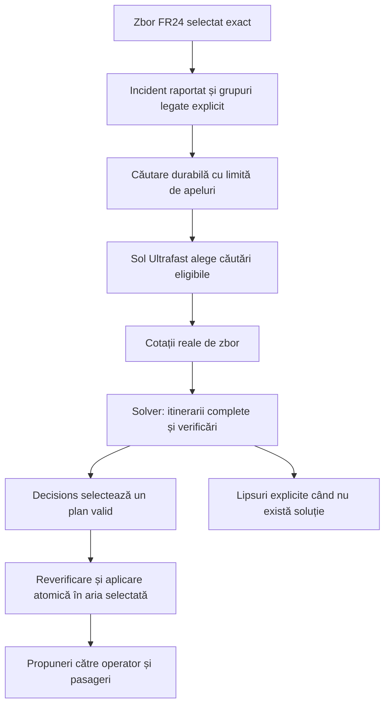

# Airport Recovery Live

## Recuperare asistată a pasagerilor, cu date și cotații reale

**Versiune:** 2.0 — 31 octombrie 2026. Acest document descrie produsul live actual. Conceptul inițial a fost pregătit pentru secțiunea AUTOPILOT a [Craiova Hackathon](https://www.craiovahackathon.ro/); imaginile de concept rămân repere vizuale.

**Implementare:** FastAPI + React/TypeScript, disponibilă într-o singură instanță locală la `http://localhost:8080`. [README](../README.md) descrie operarea; [raportul de verificare](verification/report.md) separă probele reale, testele offline și verificările rămase.

**Promisiunea produsului:** un operator pornește de la un zbor identificat și un incident, precizează persoanele afectate și primește alternative bazate pe surse reale, cu verificări explicite și lipsuri vizibile. Aplicația asistă planificarea; nu cumpără bilete, nu rezervă camere și nu comandă vehicule.

## 1. Utilizatori și scop

Clientul comercial propus este compania aeriană, iar utilizatorul principal este coordonatorul operațional sau echipa de handling. Pasagerul primește o propunere individuală și își poate comunica preferința. Aeroportul oferă context și poate fi partener operațional; nu presupunem că deține inventarul comercial al companiilor aeriene.

Problema și cerințele inițiale pot fi ipoteze introduse de echipă. Grupurile generate sunt marcate ca date de planificare sintetice și nu devin identități verificate. Pentru persoane reale se importă un manifest. În ambele situații, transportul și cazarea admise în planificarea live provin din cotații reale sau servicii documentate de operator.

Aria automată actuală cuprinde căutarea zborurilor pentru grupuri explicit legate de un caz, evaluarea inventarului deja documentat și selecția unei propuneri. Cazarea și transportul terestru au fluxuri separate de obținere a datelor. O legătură lipsă între aeroport, stație și hotel rămâne o lipsă; coordonatele apropiate nu o înlocuiesc.

## 2. Fluxul operatorului

1. **Identifică zborul.** În **Start recovery**, introduce numărul și data UTC a primei observări. Flightradar24 poate întoarce mai multe curse; operatorul selectează exact cursa. O căutare fără rezultat nu înseamnă anulare.
2. **Înregistrează incidentul.** Alege perturbarea zborului sau indisponibilitatea destinației și descrie condiția raportată. Aceasta nu modifică afirmațiile furnizorului despre zbor.
3. **Leagă grupurile afectate.** Datele provin dintr-un manifest sau din ipoteze explicite. Grupurile trebuie să indice același zbor original. Un caz fără grupuri rămâne în starea „necesită date despre pasageri”.
4. **Pornește căutarea.** Selectează grupurile cazului, obiectivul și limita de apeluri. Căutarea automată nu înlocuiește alocările grupurilor din afara selecției.
5. **Verifică rezultatul.** Urmărește etapele reale, furnizorii, cotațiile și motivele excluderii alternativelor. O propunere validă poate coexista cu alte cotații respinse. Numărul pasagerilor fără soluție este separat de istoricul căutărilor nereușite.
6. **Completează serviciile lipsă.** Hotelurile necesită date și ocupare explicite, costuri obligatorii cunoscute și conexiuni fizice independente. Un serviciu introdus de operator necesită dovezi, capacitate, preț, orar și valabilitate.
7. **Primește preferința pasagerului.** Acceptarea sau refuzul actualizează aceeași stare operațională. Acceptarea nu confirmă o rezervare la furnizor. Confirmarea externă este o acțiune distinctă, documentată pentru fiecare segment.

Contextul FR24 are retenție limitată. Reîmprospătarea unui caz trebuie să păstreze aceeași cursă; nu selectăm automat un alt zbor. Înregistrarea unui caz nou nu resetează operațiunea existentă.

## 3. Ce reprezintă fiecare sursă

| Date | Sursă și utilizare | Limită explicită |
|---|---|---|
| Cursa și observațiile aeronavei | Flightradar24, cu sursă și timp | Nu furnizează inventar de bilete; absența din rezultate nu dovedește anularea |
| Incident și condiții | Raportul operatorului | Nu constituie o confirmare externă a închiderii aeroportului |
| Grupuri de pasageri | Manifest importat sau ipoteze de planificare marcate | Grupurile generate nu pot primi confirmări reale de rezervare |
| Cotații de zbor | Nuitee Flights; adaptor Duffel alternativ, dacă are acces autorizat | Disponibilitatea și prețul unei căutări nu sunt locuri reținute |
| Cotații hoteliere | Nuitee / LiteAPI; adaptor Booking conform accesului contului | Date, ocupare și taxe obligatorii; niciun prebook sau plată |
| Proprietăți hoteliere | Coordonate ale furnizorului, metadate și fus orar derivat | Hotelul nu este plasat la aeroport și nu implică un shuttle |
| Transferuri private UK | Airport Pickups London, GBP per vehicul | Cotații separate; fără durată/sosire verificată, rezervare sau integrare în bugetul EUR |
| Autocare programate | Adaptor Distribusion, cu acces de producție separat | Stații reale, vârste explicite și conexiuni până la stații; accesul nu este presupus |
| Hartă și rute rutiere | Google Maps/Places/Routes; surse publice documentate când nu este configurat Google | O rută și o durată estimată nu sunt un vehicul disponibil |
| Transport public și conversie FX | Adaptoare pure Google TRANSIT și ECB, cu teste offline | Nu sunt încă fluxuri conectate în produs și nu completează inventarul |

Eșecul unui furnizor configurat rămâne vizibil. Nu este înlocuit cu inventar sintetic sau cu un răspuns AI prestabilit. O cheie prezentă indică configurare; numai verificarea reală demonstrează accesul la operația testată.

## 4. Căutări durabile pe incident

Fiecare încercare păstrează selecția grupurilor, obiectivul, limita de apeluri, etapele și rezultatele într-un registru persistent. Interfața arată apelurile expediate și stările lor, nu un procent de progres inventat.

Repetarea aceleiași cereri și chei recuperează încercarea existentă. O întrerupere cu rezultat necunoscut nu provoacă reluarea automată a apelurilor către furnizori. O încercare nouă este explicită și poate genera costuri noi.

Anularea oprește expedierile și aplicările ulterioare. Un apel deja în curs poate totuși termina și poate fi facturat; rezultatul lui rămâne în registru. Interfața distinge cererea de anulare de starea finală.

Hotelurile și transportul terestru selectate fără intrările sau legăturile necesare produc cerințe explicite. Ele nu declanșează o căutare automată completă doar pentru că există un checkbox.

## 5. Constrângeri și sensul unei propuneri fezabile

Backendul verifică indivizibilitatea grupurilor, capacitățile documentate, continuitatea fizică și temporală, compatibilitatea cu accesibilitatea declarată, termenele, bugetele și utilizarea vehiculelor. Căutarea este limitată; nu demonstrează optimalitatea globală.

Fiecare propunere trebuie să ajungă la destinația grupului. O cameră de hotel singură nu înseamnă recuperarea călătoriei. În live, itinerariile pot include până la șase segmente pentru a reprezenta și transferurile fizice ale unei șederi la hotel.

Trecerea peste miezul nopții nu creează singură o obligație de cazare. Așteptările dintre servicii, inclusiv conexiunile din cotațiile de zbor, sunt afișate cu durata efectivă și fusul orar local când este cunoscut. Accesibilitatea declarată necesită compatibilitate documentată. Nu există încă o politică obligatorie de odihnă structurată în schema grupului; o instrucțiune liberă nu garantează validarea unei asemenea condiții.

Costurile obligatorii ale hotelului sunt separate de suma de bază a furnizorului. Taxele incluse nu sunt adăugate din nou. Taxele lipsă sau într-o monedă fără conversie admisă lasă totalul pentru buget necunoscut și împiedică folosirea cotației într-un plan complet calculat.

La importul unei cotații hoteliere, serverul poate verifica automat intervalul de check-in și limita de checkout din politica proprietății exacte, în fusul orar derivat din coordonatele sale. Fără o oră finală de check-in publicată, este admisă automat numai ora exactă de început; sosirea târzie nu este presupusă. Politicile incomplete, contradictorii, expirate, cu instrucțiuni speciale sau cu ore locale ambigue exclud proprietatea și păstrează motivul. Operatorul poate declara separat că a convenit orele cu proprietatea; această declarație are proveniență distinctă și nu reprezintă o rezervare. Niciuna dintre căi nu creează un transfer până la hotel.

Bugetele sunt verificate față de costurile documentate ale propunerii, nu față de o plată viitoare garantată. Cotațiile pot expira și necesită revalidare. Prețul APL rămâne în GBP. Un curs ECB, chiar cu o marjă explicită a operatorului, poate descrie numai o estimare sau o alocație de planificare; nu devine preț EUR al furnizorului și nu garantează costul de decontare. Conversia FX nu este conectată la solver.

## 6. Propunere, preferință și confirmare

- **Propus:** există un itinerar verificat pe datele și versiunea curente; evidențele locale previn alocări contradictorii în aplicație, dar nu rețin stoc la furnizor.
- **Acceptat de pasager:** preferința este înregistrată; rezervarea externă rămâne în așteptare.
- **Refuzat sau expirat:** înregistrările locale asociate sunt eliberate. O cotație veche nu este prezentată drept ofertă activă.
- **Confirmat extern:** operatorul furnizează referințe pentru fiecare segment al unui grup real. Acestea sunt afirmații documentate ale operatorului, nu verificare automată prin API-ul furnizorului.

Operațiile sunt idempotente și autorizate pentru grupul respectiv. Un rezultat incert păstrează cererea originală pentru recuperare. Grupurile deja confirmate extern nu sunt înlocuite automat de o nouă căutare pe incident. Alocările neafectate din afara ariei selectate sunt păstrate.

## 7. Interfață și direcție vizuală

Harta domină spațiul de lucru; lista de resurse, sumarul cazului, cronologia și inspectorul oferă context. Designul păstrează panouri clare, tipografie lizibilă, accente cyan/amber/mint și teme luminoasă/întunecată. Culorile sunt însoțite de text și simboluri.

| Nivel | Scop |
|---|---|
| Regiune | Compararea aeroporturilor, stațiilor, proprietăților și serviciilor sursate |
| Aeroport/proprietate | Localizarea punctelor relevante și a legăturilor lipsă |
| Pasager | Grupul, constrângerile, propunerea și preferința sa |

Google Maps 3D a randat geografia reală. Acoperirea detaliată a clădirilor și fidelitatea față de concepte nu sunt garantate. Scena locală Three.js și modelele proprii sunt reprezentări arhitecturale, nu măsurători. În live nu animăm cotațiile, autobuzele sau grupurile ca și cum ar avea poziții GPS observate. Traficul observat își păstrează sursa și vechimea.

### Repere de design păstrate

Aceste imagini au fost generate pentru conceptul inițial. Geometria, inventarul, numerele și etichetele de simulare din imagini sunt ilustrative; nu sunt capturi ale produsului actual sau dovezi de rezervare. Folosim compoziția și ierarhia vizuală, nu valorile fictive.

Vedere de ansamblu, selecție și inspector contextual.

Relația dintre un serviciu indisponibil, grupurile afectate și alternativele reale.

Context regional pentru recuperarea pasagerilor. Produsul nu emite instrucțiuni de deviere și nu este un sistem de control al traficului aerian.

[Prompturile imaginilor](mockups/prompts.json) păstrează proveniența conceptelor istorice.

## 8. Arhitectură și interacțiune AI

| Componentă | Responsabilitate actuală |
|---|---|
| React/TypeScript | Spațiul operatorului, formularele de caz, progresul, harta și pagina pasagerului |
| FastAPI | Autorizare, contracte validate, integrarea furnizorilor și orchestrare |
| Sol Ultrafast | Interpretare structurată și selecția căutărilor eligibile |
| Decisions | Alegerea dintre propuneri calculate și validate |
| Solver Python | Fezabilitate, alocări, costuri și păstrarea ariei neafectate |
| SQLite | Stare versionată, registrul căutărilor, idempotency și audit |
| SSE | Actualizări ale stării comune către interfețe |
| GPT-Live | Transport vocal și delegare; verificarea unei conversații reale complete rămâne separată |

Modelele nu decid singure dacă o capacitate, un preț sau un transfer este valid. Backendul reverifică înainte de aplicare. Nicio decizie live nu este înlocuită cu un răspuns prestabilit când API-ul eșuează.

Comenzile vocale/text pot porni o căutare durabilă pentru un caz existent, identificat explicit prin ID sau printr-un zbor fără ambiguitate în cererea curentă. Sunt admise numai grupurile deja legate de acel caz; rezervările confirmate și alocările din afara selecției sunt protejate. Confirmarea vocală de pornire descrie cererea înregistrată, nu un itinerar final sau o rezervare.

Limita comenzii include apelul de interpretare: implicit opt apeluri în total, dintre care cel mult șapte pentru căutarea durabilă. Formularul cazului are separat limita apelurilor propriei căutări. O interpretare cu rezultat necunoscut nu este retrimisă automat. Implementarea are teste offline; verificarea live a acestei intrări vocale/text este încă în așteptare. Formularul cazului are deja proba reală descrisă mai jos. O sesiune WebRTC reușită cu sunet sintetic nu validează microfonul, delegarea, redarea și întreruperea într-o conversație reală.

Cheile private rămân pe server. Cheia publică Maps pentru browser necesită restricțiile aplicației. Contextul temporar FR24 nu este copiat în exporturile portabile sau backupurile operaționale; retenția și drepturile furnizorilor rămân explicite.

## 9. Verificări reale și limite actuale

La 31 octombrie 2026 au fost observate următoarele rezultate pe instanța principală:

- Identificarea cursei FR24 EK5 DXB→LHR, crearea cazului și legarea unui grup explicit de planificare cu doi adulți.
- O căutare durabilă a folosit patru apeluri: Responses, două căutări Nuitee paralele și Decisions. Au fost întoarse 20 de cotații și înregistrată o propunere validă pentru doi pasageri, fără excepții; grupul existent din afara selecției a rămas neatins.
- Circuitul căutării a durat aproximativ 12,1 secunde într-o singură rulare. Nu este o promisiune de latență sau o medie/p95.
- Interfața APL a afișat șase cotații reale în GBP per vehicul pentru o călătorie UK, fără rezervare sau reținere.
- O probă Nuitee a întors zece cotații hoteliere complete pentru LHR, cu coordonate reale și fusul Europe/London. Prețurile hoteliere au fost afișate și prin interfață; importul lor într-un itinerar complet cu transferuri nu este încă verificat.
- Pasagerul a acceptat o propunere reală ca preferință, după care cotația a expirat în mod normal. Nu a fost creată o rezervare la furnizor.

Probele nu demonstrează acoperire universală, disponibilitate viitoare, rezervări reale sau recuperare automată completă cu hotel și transfer. [Raportul detaliat](verification/report.md) menține această separare și rezultatele testelor.

Validarea automată a orelor șederii pe baza politicii proprietății este implementată separat; nu este inclusă în probele reale de mai sus.

## 10. Criterii de acceptare ale fluxului live asistat

- Selectarea exactă a zborului și a grupurilor precedă căutările; un caz nou nu șterge operațiunea.
- Fiecare serviciu folosit are proveniență, orar, cost și capacitate suficiente pentru verificare. Necunoscutele nu devin zero sau stoc disponibil.
- Propunerea ajunge la destinație și păstrează grupul; hotelul fără conexiuni fizice nu trece drept recuperare completă.
- Rezultatele întârziate sunt reverificate; cererile repetate nu dublează aplicarea sau expedierile deja înregistrate.
- Anularea și rezultatele necunoscute sunt explicite, fără retry automat al apelurilor taxabile.
- Alternativa exclusă, cerința nerezolvată și așteptarea informativă sunt prezentate separat.
- Acceptarea de pe telefon este preferință, iar confirmarea externă necesită dovezi pentru toate segmentele.
- Cel puțin un flux real zbor→caz→cotații→propunere este verificat; hotelul cu transferuri și fluxul vocal complet au verificări distincte înainte de a fi declarate funcționale cap-coadă.
- Harta, atribuirea surselor și panourile sunt lizibile pe desktop și telefon; rezultatele nu folosesc imagini de concept drept fundal operațional.

## 11. Operare și dezvoltare internă

Instanța principală rămâne cea de la portul 8080. Actualizările păstrează baza persistentă și nu resetează starea utilizatorului. Publicarea pe un domeniu HTTPS este o etapă separată; nu există o instanță publică declarată în această verificare.

Modul intern `simulation` și fixture-urile sintetice sunt păstrate pentru regresii și dezvoltare izolată. Nu sunt surse de inventar pentru live, nu apar ca alternativă la un furnizor eșuat și nu fac parte din fluxul comercial descris aici. Resetarea sintetică este refuzată în live.

Limitele de apeluri controlează o căutare, nu factura totală a contului. Costurile furnizorilor și condițiile conturilor se verifică înainte de operare; nu păstrăm în această specificație tarifele orientative ale conceptului inițial drept prețuri actuale.

Următoarea livrare finită urmărește recuperarea asistată pentru grupurile adulte suportate, cu propuneri reale și verificabile, plus afișarea clară a serviciilor lipsă. Integrarea rezervărilor automate, confirmarea furnizorilor și acoperirea transportului terestru în toate regiunile sunt proiecte distincte. O estimare de rută sau de curs valutar nu le substituie.
