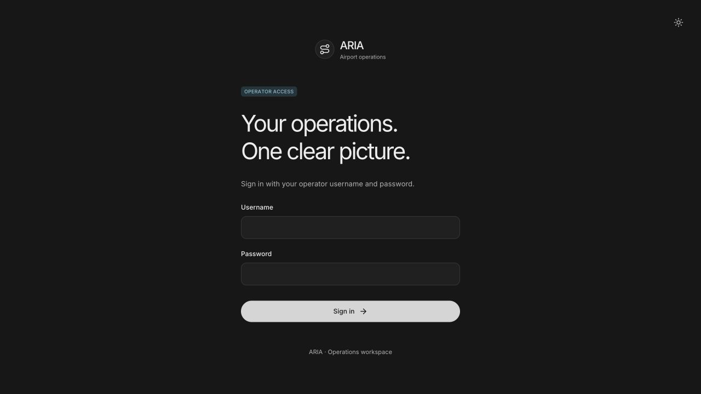

# Operator authentication verification

Verified locally on 2026-11-01 using the existing Docker Compose deployment at `http://localhost:8080`. The existing data volume was preserved; there were no active recovery jobs or running flight feed before restart. No supplier searches, bookings or operational mutations were requested.

- Browser: the signed-out workspace shows labelled username/password fields; an incorrect password shows the generic rejection; the configured account opens the workspace; reload preserves the session; Connections → Sign out returns to the login form.
- API: unauthenticated `/api/world` returns 401, `/api/ready` remains available, `/api/config` reports password authentication. The local optional API bearer token is unset.
- Backend: the full offline suite reported 3,261 passes and four failures in the isolated configuration-import fixture. Updating that fixture to preserve package-relative imports resolved all four; its targeted rerun passed. Authentication coverage includes session persistence, expiry, tampering, logout/replay, credential rotation, shared rate limiting, production cookie flags, origin rejection, password hashing, secret redaction and preserved passenger access. Solver, reservation and API suites passed in the full run.
- Frontend: 974 tests passed; TypeScript and the production build passed. The existing large scene-chunk warning remains.
- Production Compose configuration validated with an isolated dummy account, without displaying private configuration.
- Before push, integrated remote changes through `97b6c31` and updated the Google Cloud environment guard/example to require the password account while keeping the API token optional. All 54 targeted backend tests (authentication, API, configuration, solver, reservations and new scenario conversation), 19 infrastructure/release tests and 1,003 frontend tests passed; the production frontend build passed.

The form retains the existing ARIA typography, theme, input styling and cyan access label. The operations mockup supplied the visual reference; there is no separate login mockup. Desktop rendering was inspected at 1280 × 720. The screenshot contains no credentials or passenger data.

The generated local password is not stored in this report or source control. `backend/.env` stores its salted hash with file mode 0600 and is ignored by Git. For a new password, run `python3 backend/scripts/configure_operator.py --username operator --generate` and recreate the API container.
